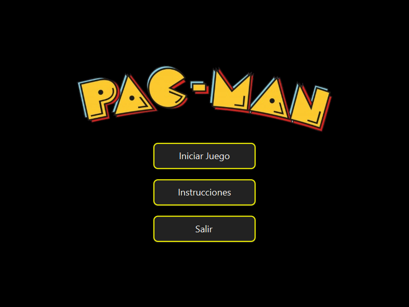
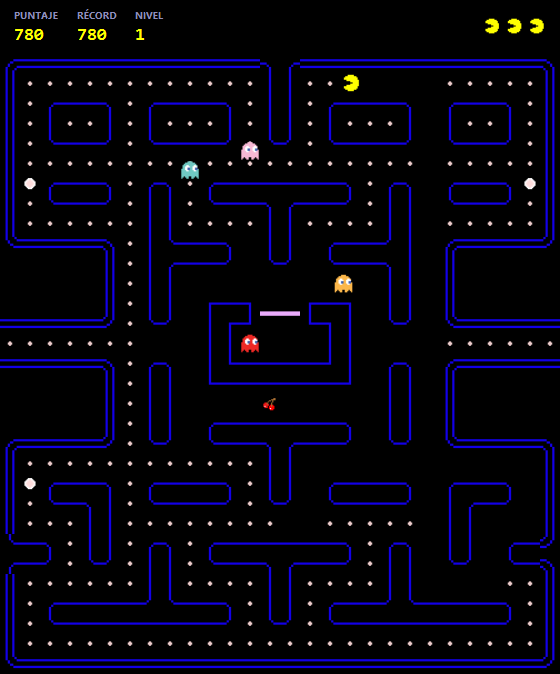
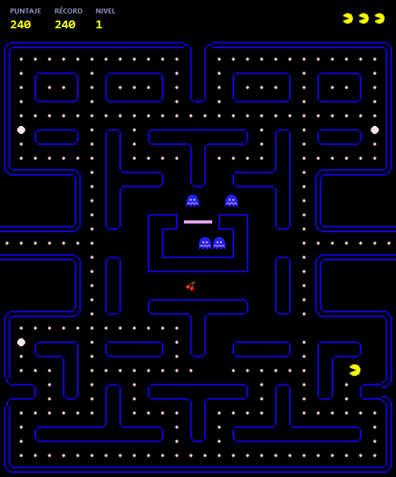
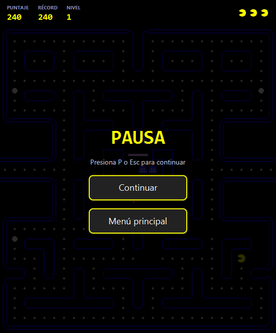
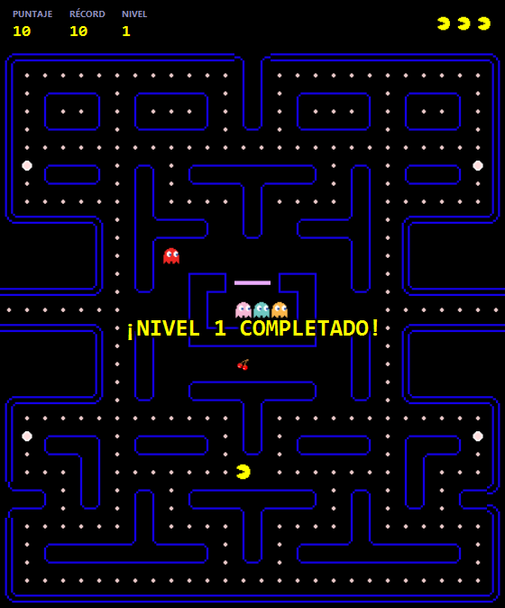
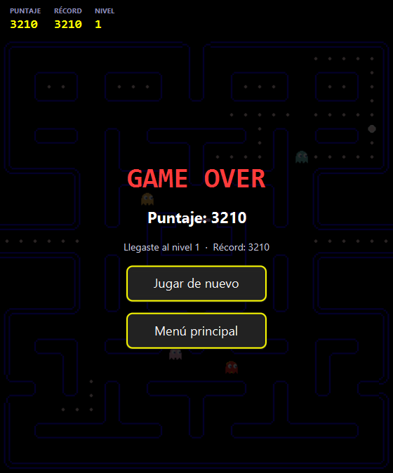

# Pac-Man · Grafos

Pac-Man de escritorio en **Java 17 + JavaFX** donde el laberinto es un **grafo**: cada casilla transitable es un vértice y los pasillos son aristas. Los fantasmas recorren ese grafo con algoritmos clásicos, y todas las estructuras de datos del juego (lista enlazada, cola, cola de prioridad, tabla hash, union-find) están implementadas desde cero.

Tarea integradora 2 · Discretas I · Universidad Icesi · 2025.

| Menú | Persecución | Pastilla de poder |
|:---:|:---:|:---:|
|  |  |  |

| Pausa | Nivel completado | Fin de partida |
|:---:|:---:|:---:|
|  |  |  |

## Cómo se juega

- **Flechas** o **W A S D** para moverse. Puedes girar antes de llegar a un cruce: Pac-Man toma la curva en cuanto el camino lo permite.
- **P** o **Esc** para pausar.
- Bolita 10 · pastilla de poder 50 · cereza 100 · fantasmas asustados 200 → 400 → 800 → 1600.
- 3 vidas, vida extra a los 10 000 puntos. Cada nivel acelera a los fantasmas y acorta el efecto de las pastillas.

## Cómo ejecutarlo

Requiere JDK 17 o superior (Maven Wrapper incluido):

```bash
cd Pacman
./mvnw javafx:run      # Windows: mvnw.cmd javafx:run
./mvnw test            # 17 pruebas JUnit 5
```

## Cómo usa los grafos

| Fantasma | Estrategia |
|---|---|
| Rojo | Persigue con **Dijkstra** sobre el grafo del laberinto, usando la `ColaPrioridad` propia |
| Rosado | Persigue con **BFS** (búsqueda en anchura) |
| Azul y naranja | Deambulan al azar sin devolverse, salvo en callejones sin salida |

- **El laberinto como grafo dirigido** (`GrafoMatrizAdyacencia`): una matriz de 31×28 se convierte en vértices con aristas arriba, abajo, izquierda y derecha. La puerta de la casa de los fantasmas es **de un solo sentido** (se puede salir pero no entrar) y los túneles laterales son una arista que une ambos extremos.
- **Concurrencia:** cada fantasma corre en su propio hilo (`FantasmaThread`), que calcula el siguiente paso; el movimiento se aplica en el hilo de JavaFX con `Platform.runLater`. Pac-Man se mueve con un ciclo de juego (`Timeline`).
- **Biblioteca de algoritmos** (`model/algoritmos`): BFS, DFS, Dijkstra, Floyd-Warshall, Kruskal y Prim sobre `GrafoListaAdyacencia`, cada uno con sus pruebas.

## Estructura

```
Pacman/src/main/java
├── estructuras/        Lista enlazada, pila, cola, cola de prioridad, tabla hash, union-find, vértice
├── model/grafo/        Grafo por matriz y por lista de adyacencia, aristas
├── model/algoritmos/   BFS, DFS, Dijkstra, Floyd-Warshall, Kruskal, Prim
├── model/ia/           IA de los fantasmas (Dijkstra, BFS, aleatoria) y su hilo
├── model/entidades/    Pac-Man, fantasmas, consumibles, movimientos
├── model/juego/        Laberinto, nivel, puntuación, estado de la partida
├── controller/         JuegoController: ciclo de juego, choques, vidas, pausa y niveles
└── ui/                 Menú, juego, marcador, pausa, fin de partida e instrucciones
```

Pruebas en `Pacman/src/test/java/Test`. `LaberintoTest` verifica que los fantasmas puedan salir de su casa y alcanzar a Pac-Man, que Pac-Man no pueda entrar a la casa, el túnel, y que Dijkstra y BFS siempre acorten el camino hacia Pac-Man.

## Autores

- **Jose David Rodríguez Pinilla** · [GitHub](https://github.com/JOSED235): estructuras de datos, grafos, algoritmos, IA de fantasmas, interfaz JavaFX y pruebas.
- **Albert Valencia Escobar**: método de ingeniería, laberinto, tabla hash del grafo, controlador y manual del jugador.
